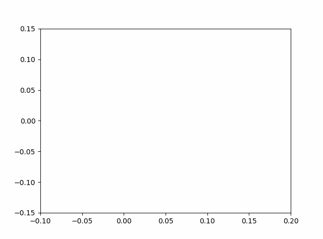

# N-Body-Simulation

Simulation von Körpern, die sich gegenseitig durch Gravitation anziehen. Aktuell umgesetzt ist der Spezialfall mit **drei Körpern** (Dreikörperproblem) in einem Jupyter-Notebook.



## Was macht das Projekt?

Drei gleich schwere Körper starten an festen Positionen mit festen Anfangsgeschwindigkeiten. Das Notebook berechnet Schritt für Schritt, wie sie sich unter ihrer gegenseitigen Anziehung bewegen, zeichnet die Bahnen und speichert eine Animation als GIF.

## Dateien

| Datei | Inhalt |
|---|---|
| `3body.ipynb` | Das gesamte Programm: Anfangsbedingungen, Berechnung, Plot, Animation |
| `basic_animation.gif` | Vom Notebook erzeugte Animation der Bahnen |
| `README.md` | Diese Übersicht |

## Ablauf im Notebook

1. **Imports** – NumPy, SciPy (für die Gravitationskonstante `G`), Matplotlib.
2. **Anfangsbedingungen** – Simulationsparameter und Startwerte der drei Körper.
3. **Berechnung** – für jeden Zeitschritt:
   - Gravitationskraft zwischen allen Körperpaaren berechnen (Newton: F = G·m₁·m₂ / r²),
   - daraus Beschleunigung `a = F / m`,
   - neue Geschwindigkeit und Position für den nächsten Zeitschritt.
4. **Plot** – Bahnen in der x-y-Ebene, Endposition als Punkt.
5. **Animation** – Bahnen wachsen Bild für Bild, Speicherung als `basic_animation.gif`.

## Wichtige Parameter

| Parameter | Wert | Bedeutung |
|---|---|---|
| `N` | 3 | Anzahl der Körper |
| `Time` | 500 s | Simulierte Gesamtzeit |
| `dt` | 0,01 s | Länge eines Zeitschritts |
| `nsteps` | 50 000 | Anzahl Zeitschritte (`Time / dt`) |
| `EPS` | 0,001 | Glättungsparameter („Softening“), verhindert Division durch null, wenn zwei Körper sich sehr nahe kommen |
| `m` | 1000 kg je Körper | Massen |
| `dt_plot` | 200 | Nur jeder 200. Zeitschritt wird als Animationsbild verwendet |

Alle Größen sind in SI-Einheiten (Meter, Sekunden, Kilogramm). Die Körper liegen nur wenige Zentimeter auseinander, die Bewegung findet in der x-y-Ebene statt (z = 0).

## Datenstruktur

Positionen, Geschwindigkeiten, Kräfte und Beschleunigungen werden in NumPy-Arrays der Form `[Körper, Zeitschritt, Raumrichtung]` gespeichert, z. B. `r[1, 500, 0]` = x-Position von Körper 1 im Zeitschritt 500. Dadurch steht nach der Rechnung die komplette Bahn jedes Körpers zur Verfügung.

## Ausführen

Voraussetzung: Python 3 mit Jupyter.

```bash
pip install numpy scipy matplotlib pillow jupyter
jupyter notebook 3body.ipynb
```

Dann alle Zellen von oben nach unten ausführen. Die Berechnung dauert je nach Rechner etwa eine Minute, der Fortschritt wird alle 10 000 Schritte ausgegeben. Ist `ffmpeg` nicht installiert, nutzt Matplotlib automatisch Pillow zum Speichern des GIFs.

## Eigene Experimente

- **Andere Startwerte:** Positionen `r[i][0]` und Geschwindigkeiten `v[i][0]` im Abschnitt „Initial conditions“ ändern.
- **Länger/genauer rechnen:** `Time` erhöhen bzw. `dt` verkleinern (mehr Schritte = längere Rechenzeit).
- **Bildausschnitt der Animation:** `xmin`, `xmax`, `ymin`, `ymax` anpassen, falls Körper aus dem Bild laufen.

## Bekannte Einschränkungen

- **Animation nur für 3 Körper:** Die Animationszelle verwendet fest `line1`–`line3`. Für ein echtes N-Körper-System müsste sie auf eine Schleife umgestellt werden.
- **Einfaches Integrationsverfahren:** Die Bewegung wird mit einem einfachen expliziten Verfahren (ähnlich Euler) fortgeschrieben. Über lange Zeiten kann sich dadurch ein Fehler in der Gesamtenergie aufbauen. Genauer und stabiler wäre z. B. das Velocity-Verlet- oder Leapfrog-Verfahren.
- **Softening-Formel:** `EPS²` wird zu `|r|³` addiert. Üblich ist `(|r|² + EPS²)^(3/2)`; im Ergebnis ist der Unterschied bei den aktuellen Werten gering.
- **Laufzeit:** Die Kraftberechnung läuft in reinen Python-Schleifen (Aufwand wächst mit N² × Zeitschritte). Für viele Körper wäre eine vektorisierte NumPy-Variante deutlich schneller.
- **Ungenutzter Code:** Einige Imports (`normal`, `Enum`, `clear_output`) und Variablen (`size`, `v0_max`) werden derzeit nicht verwendet – vermutlich Reste für zufällige Startwerte bzw. eine geplante `Body`-Klasse.
